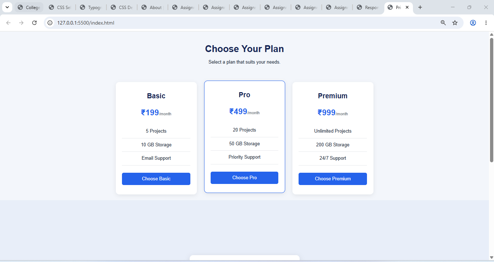

# Assignment 7.2 — Pricing Cards & Centered Login Form

## 1. Aim

To design a webpage containing three pricing cards — Basic, Pro, and Premium — and a centered login form using HTML, CSS, and Flexbox.

## 2. Requirements

- Visual Studio Code
- A web browser
- Basic knowledge of HTML and CSS

## 3. Theory

CSS Flexbox is a layout model used to arrange elements in rows or columns. It helps create flexible, responsive layouts.

The `display: flex` property enables Flexbox. The `justify-content` property controls alignment along the main axis, while `align-items` controls alignment along the cross axis. The `flex-direction` property determines whether items are arranged in a row or column.

Pricing cards display the prices, features, and available options of different plans. A centered login form allows users to enter their credentials.

## 4. Explanation of Flexbox Properties

| Property                  | Purpose                                                                 |
| ------------------------- | ----------------------------------------------------------------------- |
| `display: flex`           | Enables Flexbox layout.                                                 |
| `justify-content: center` | Centers items along the main axis.                                      |
| `align-items: center`     | Aligns items along the cross axis.                                      |
| `align-items: stretch`    | Makes cards stretch to match the container's available cross-axis size. |
| `flex-direction: row`     | Arranges pricing cards horizontally.                                    |
| `flex-direction: column`  | Arranges form elements vertically.                                      |
| `flex-wrap: wrap`         | Allows cards to move to another line when space is limited.             |
| `gap`                     | Adds space between cards or form elements.                              |
| `min-height: 100vh`       | Makes the login section at least as tall as the viewport.               |
| `@media`                  | Changes the layout for smaller screens.                                 |

## 8. Observation

**Observation:** Flexbox provides consistent alignment and spacing. The media query improves the layout on mobile screens.

## 9. Result

A webpage containing three aligned pricing cards — Basic, Pro, and Premium — and a centered login form was successfully created using HTML and CSS Flexbox.

## 10. Conclusion

This assignment demonstrates the practical use of Flexbox properties such as `justify-content`, `align-items`, and `flex-direction`. It also demonstrates responsive web design using CSS media queries.

## 11. OUTPUT SCREENSHOTS

